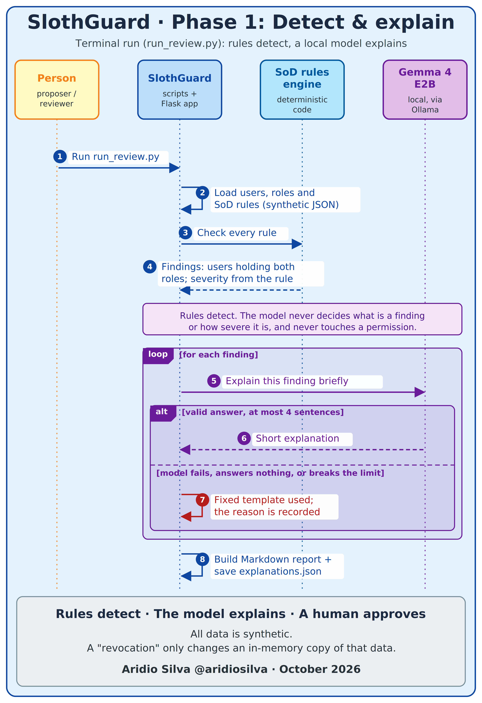
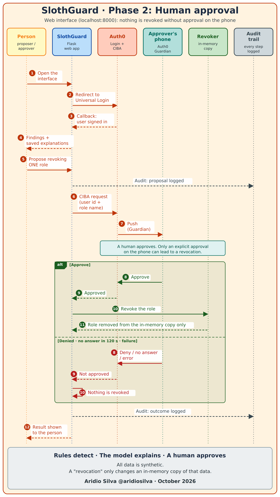

# SlothGuard

[Leia em português](README_PT.md)

A lazy access reviewer. Plain rules find segregation-of-duties (SoD) conflicts, a small open-weight
model running on your own computer explains each one, and nothing is revoked unless a human approves
it on their phone through Auth0.

> **Rules detect, the model explains, a human approves.**
> The model never decides what is a finding or how severe it is, and it never touches a permission.

Built for the DEV [Hacktoberfest Open-Source AI Challenge, Week 3: Slow and Steady](https://dev.to/challenges/hacktoberfest-week3-2026-10-19).
Project started on 2026-10-22 (challenge window: 2026-10-19 to 2026-10-25).

All data is synthetic. A "revocation" only changes an in-memory copy of that data.

## What it does

1. Loads users and roles (`data/synthetic/users.json`) and SoD rules (`data/synthetic/sod_rules.json`).
2. Finds every user who holds both roles of a rule (deterministic code, severity comes from the rule).
3. Asks a local model (Gemma 4 E2B through Ollama) for a short explanation of each finding. The answer
   is limited to four sentences by the code; if the model fails, answers nothing or breaks the limit,
   a fixed template is used and the reason is recorded.
4. Builds a Markdown report.
5. In a small web interface (sign-in with Auth0), a person can propose revoking one role. Auth0
   sends a push to the approver's phone (Auth0 Guardian, CIBA). The role is revoked only after
   "approve". Denied, unanswered (120 s) or failed means nothing is revoked, and every step is
   written to an audit trail.

### Sequence of operation





*Rules detect, the model explains, a human approves.*

## Run it (Windows PowerShell)

Requirements: Python 3.10 or newer, [Ollama](https://ollama.com) with the model pulled
(`ollama pull gemma4:e2b`), and an Auth0 tenant (see below).

```powershell
python -m venv .venv
.\.venv\Scripts\python -m pip install -r requirements-dev.txt -r requirements.txt
Copy-Item .env.example .env        # then fill in the Auth0 values; never commit .env
.\.venv\Scripts\python -m pytest -q
```

At the time of writing the suite gives `177 passed, 1 skipped` (the skipped test needs a running Ollama:
set `RUN_OLLAMA_TESTS=1` to run it).

```powershell
.\.venv\Scripts\python scripts\run_review.py     # explain every finding with the local model, save the report and a run log
.\.venv\Scripts\python scripts\run_app.py        # web interface on http://localhost:8000
```

Open exactly `http://localhost:8000` (not `127.0.0.1`): that is the address registered in Auth0.
`run_review.py` stops at once if Ollama cannot be reached. The web page reads the explanations
saved by `run_review.py` (`data/output/explanations.json`, not committed).

## Auth0 setup (what this project used)

- A **Regular Web Application** with the callback URL `http://localhost:8000/callback` and the
  logout URL `http://localhost:8000/`.
- The **Client Initiated Backchannel Authentication (CIBA)** grant type enabled in the application's
  advanced settings, with the **Guardian Push** notification channel.
- The **Push Notification (Auth0 Guardian)** factor enabled under Security > Multi-factor Auth.
- A test user enrolled in Guardian (the approver). Its Auth0 user id goes in `AUTH0_TEST_USER_ID`.
- `.env` holds `AUTH0_DOMAIN`, `AUTH0_CLIENT_ID`, `AUTH0_CLIENT_SECRET` and `AUTH0_TEST_USER_ID`
  (plus `OLLAMA_HOST` and `OLLAMA_MODEL`). `.env.example` lists the names without values.

Honest note: I checked all of this on an Auth0 tenant during its free trial period. I have not
verified whether asynchronous approval is available after the trial.

## How it is built

```
src/slothguard/
  models.py         immutable users, rules and findings
  rules/            the deterministic SoD engine and the JSON loaders
  llm/              explanations (cache, fallback, sentence limit) and the Ollama client
  report.py + review.py   report builder and the full review flow
  auth/             the human-approval gate (approvals.py) and the Auth0 CIBA gateway (ciba.py)
  web/              Flask app, templates and the Auth0 login (Authlib)
  revoker.py        the in-memory "revocation"
tests/              177+ tests, written before the code they cover
scripts/            run_review.py, run_app.py, review_quality.py and two manual Auth0 checks
docs/               constitution, spec, tasks, and docs/evidence with real measurements
```

Tests came first for each piece: the history shows `test:` commits before the matching `feat:` ones.
The spec and rules of the project are in `docs/constitution.md` and `docs/spec.md`.

## Measurements (real runs, with their conditions)

See `docs/evidence/`. On a Dell all-in-one with an Intel Core i5-1334U, 16 GB of RAM in a single
memory channel and no dedicated GPU, Gemma 4 E2B through Ollama generated 13 to 22 tokens per second.
Turning the model's thinking trace off cut the generated tokens by about 81%. Explaining the 8 findings
took 97 to 157 seconds across three runs (free memory of 6.1, 4.3 and 1.1 GB; the spread was not
diagnosed). The Ollama version was 0.40.8 for the terminal measurements and 0.40.10 later.

## Limits

- Synthetic data only; no real directory is connected.
- The proposer and the approver can be the same Auth0 user in the demo. A real deployment needs two people.
- The approval message contains the user id and the role name, and that text goes to Auth0.
- The web server is Flask's development server, meant for local use.

## Credits

Built with AI help (pair-programmed with Claude). Libraries: Flask, Authlib, Requests, pytest.
Model: Gemma 4 E2B, run through Ollama. Identity and approval: Auth0 (Universal Login, CIBA, Guardian).
The Auth0 and Ollama documentation were used for the request formats.

## Commits after the submission deadline

None so far.
