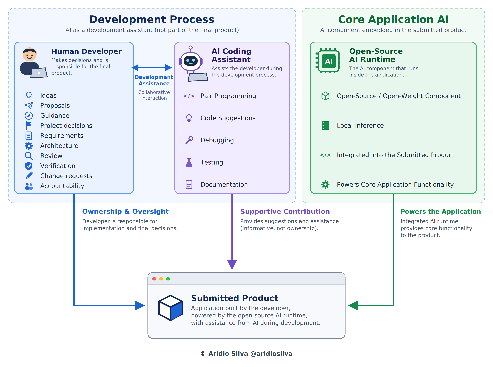

# SlothGuard

[Read in English](README.md)

Um revisor de acessos preguiçoso. Regras simples encontram conflitos de segregação de funções (SoD), um modelo pequeno de pesos abertos, executado no seu próprio computador, explica cada um deles, e nada é revogado a menos que uma pessoa aprove no celular, pelo Auth0.

**Regras detectam, o modelo explica, uma pessoa aprova.** O modelo nunca decide o que é um achado nem qual a sua severidade, e nunca toca em uma permissão.

Criado para o DEV Hacktoberfest Open-Source AI Challenge, Semana 3: Slow and Steady. Projeto iniciado em 2026-10-22 (janela do desafio: 2026-10-19 a 2026-10-25).

Todos os dados são sintéticos. Uma "revogação" só altera uma cópia em memória desses dados.

## O que ele faz

- Carrega usuários e papéis (`data/synthetic/users.json`) e regras de SoD (`data/synthetic/sod_rules.json`).
- Encontra todo usuário que tem os dois papéis de uma regra (código determinístico; a severidade vem da regra).
- Pede a um modelo local (Gemma 4 E2B pelo Ollama) uma explicação curta de cada achado. O código limita a resposta a quatro frases; se o modelo falhar, não responder nada ou passar do limite, é usado um texto-padrão e o motivo é registrado.
- Monta um relatório em Markdown.
- Em uma pequena interface web (login pelo Auth0), uma pessoa pode propor a revogação de um papel. O Auth0 envia uma notificação ao celular do aprovador (Auth0 Guardian, CIBA). O papel só é revogado depois de "aprovar". Negado, sem resposta (120 s) ou com falha significa que nada é revogado, e cada passo é registrado em uma trilha de auditoria.

### Sequência de operação

**Fase 1: detectar e explicar** (execução de `run_review.py` no terminal).


**Fase 2: aprovação humana** (interface web em `localhost:8000`).


*Regras detectam, o modelo explica, uma pessoa aprova.*

## Como executar (Windows PowerShell)

Requisitos: Python 3.10 ou mais novo, Ollama com o modelo baixado (`ollama pull gemma4:e2b`) e um tenant do Auth0 (veja abaixo).

```powershell
python -m venv .venv
.\.venv\Scripts\python -m pip install -r requirements-dev.txt -r requirements.txt
Copy-Item .env.example .env        # depois preencha os valores do Auth0; nunca faça commit do .env
.\.venv\Scripts\python -m pytest -q
```

No momento da escrita, a suíte dá 177 aprovados e 1 pulado (o teste pulado exige o Ollama rodando: defina `RUN_OLLAMA_TESTS=1` para executá-lo).

```powershell
.\.venv\Scripts\python scripts\run_review.py     # explica cada achado com o modelo local, salva o relatório e um registro da execução
.\.venv\Scripts\python scripts\run_app.py        # interface web em http://localhost:8000
```

Abra exatamente `http://localhost:8000` (não `127.0.0.1`): esse é o endereço registrado no Auth0. O `run_review.py` para imediatamente se o Ollama não puder ser alcançado. A página web lê as explicações salvas pelo `run_review.py` (`data/output/explanations.json`, não versionado).

## Configuração do Auth0 (o que este projeto usou)

- Uma Regular Web Application com a URL de callback `http://localhost:8000/callback` e a URL de logout `http://localhost:8000/`.
- O tipo de concessão Client Initiated Backchannel Authentication (CIBA) habilitado nas configurações avançadas da aplicação, com o canal de notificação push do Guardian.
- O fator Push Notification (Auth0 Guardian) habilitado em Security > Multi-factor Auth.
- Um usuário de teste cadastrado no Guardian (o aprovador). O id desse usuário no Auth0 vai em `AUTH0_TEST_USER_ID`.
- O `.env` guarda `AUTH0_DOMAIN`, `AUTH0_CLIENT_ID`, `AUTH0_CLIENT_SECRET` e `AUTH0_TEST_USER_ID` (além de `OLLAMA_HOST` e `OLLAMA_MODEL`). O `.env.example` lista os nomes sem os valores.

Nota honesta: verifiquei tudo isso em um tenant do Auth0 durante o período de teste gratuito. Não verifiquei se a aprovação assíncrona está disponível depois do período de teste.

## Como é construído

```
src/slothguard/
  models.py         usuários, regras e achados imutáveis
  rules/            o motor determinístico de SoD e os leitores de JSON
  llm/              explicações (cache, texto-padrão, limite de frases) e o cliente do Ollama
  report.py + review.py   construtor do relatório e o fluxo completo da revisão
  auth/             a barreira de aprovação humana (approvals.py) e o gateway CIBA do Auth0 (ciba.py)
  web/              app Flask, templates e o login do Auth0 (Authlib)
  revoker.py        a "revogação" em memória
tests/              mais de 177 testes, escritos antes do código que cobrem
scripts/            run_review.py, run_app.py, review_quality.py e duas verificações manuais do Auth0
docs/               constituição, especificação, tarefas e docs/evidence com medições reais
```

Os testes vieram primeiro em cada peça: o histórico mostra commits `test:` antes dos commits `feat:` correspondentes. A especificação e as regras do projeto estão em `docs/constitution.md` e `docs/spec.md`.

## Medições (execuções reais, com as suas condições)

Veja `docs/evidence/`. Em um Dell all-in-one com Intel Core i5-1334U, 16 GB de RAM em canal único de memória e sem GPU dedicada, o Gemma 4 E2B pelo Ollama gerou de 13 a 22 tokens por segundo. Desligar o rastro de raciocínio do modelo reduziu os tokens gerados em cerca de 81%. Explicar os 8 achados levou entre 63,5 e 157,4 segundos nas execuções registradas em `docs/evidence/` (tabela abaixo). A variação não foi diagnosticada, e a memória livre sozinha não a explica: a execução mais rápida tinha só 2,1 GB livres, embora o modelo provavelmente ainda estivesse carregado da execução anterior. A versão do Ollama foi a 0.40.8 nas medições de terminal e a 0.40.10 depois.

| Data | Total | Condições | Evidência |
|---|---|---|---|
| 23/10 | 97,1 s | RAM livre de 6,1 GB; Ollama iniciado à mão; ChatGPT fechado | `review-run.md` |
| 23/10 | 139,0 s | RAM livre de 4,3 GB; Claude e um navegador ainda abertos; modelo descarregado antes da execução | `review-run-4.3gb-2026-10-23.md` |
| 23/10 | 157,4 s | RAM livre de 1,1 GB; execução não limpa | `review-run-low-ram.md` |
| 24/10 | 98,9 s | Não registradas; a execução mostrada no vídeo da demo | (vídeo) |
| 25/10 | 104,1 s | Modo avião, dois navegadores abertos; RAM e conectividade não medidas | `review-run-airplane-two-browsers-2026-10-25.md` |
| 25/10 | 63,5 s | Offline (o teste de conectividade retornou False); RAM livre de 2,1 GB | `review-run-offline-2026-10-25.md` |

Condições das duas execuções de 25/10: `docs/evidence/offline-test-2026-10-25.md`.

## Limites

- Apenas dados sintéticos; nenhum diretório real está conectado.
- Na demonstração, quem propõe e quem aprova podem ser o mesmo usuário do Auth0. Uma implantação real precisa de duas pessoas.
- A mensagem de aprovação contém o id do usuário e o nome do papel, e esse texto vai para o Auth0.
- O servidor web é o servidor de desenvolvimento do Flask, pensado para uso local.

## Créditos

Construído com ajuda de IA (pair programming com o Claude). Bibliotecas: Flask, Authlib, Requests, pytest. Modelo: Gemma 4 E2B, executado pelo Ollama. Identidade e aprovação: Auth0 (Universal Login, CIBA, Guardian). A documentação do Auth0 e do Ollama foi usada para os formatos de requisição.

### Pair programming com IA: papéis e responsabilidades

Desenvolvi o SlothGuard como desenvolvedor humano em pair programming com um assistente de código de IA, o Claude.

**Desenvolvedor humano.** Contribuí com as ideias, propostas, orientações e decisões de projeto. Também defini os requisitos e a arquitetura, fiz a revisão e a verificação do código, apresentei solicitações de mudança e sou responsável pelo produto final. O desenvolvedor é dono da implementação e das decisões finais.

**Direção.** O projeto foi concebido, dirigido e levado a termo por mim. Defini o objetivo, tomei as decisões de projeto, conduzi cada iteração, e testei e aceitei o resultado. A IA assistiu; ela não definiu a direção.

**Assistente de código de IA.** O Claude me auxiliou durante o desenvolvimento com pair programming, sugestões de código, depuração, testes e documentação. A contribuição foi de apoio: ofereceu sugestões e assistência, sem a propriedade do resultado.

**Minhas contribuições na documentação.** As ideias de ilustrar o sistema com capturas de tela reais (o push do Auth0 Guardian no celular, a página web que pede para aprovar ou negar a revogação, os logs do tenant do Auth0), de capturar a aba Network do navegador e o console do servidor Flask e de acrescentar tabelas com dados medidos do processamento foram minhas. Também foram minhas as solicitações de dividir o diagrama de sequência em uma imagem por fase, de aumentar o texto, de encurtar os nomes dos atores para reduzir a largura e de ampliar o papel humano no diagrama do pair programming com ideias, propostas, orientações, decisões de projeto e solicitações de mudança. O assistente produziu os rascunhos e as imagens; eu revisei cada um e pedi as alterações.

**Trabalho manual.** Executei pessoalmente todas as etapas manuais. Instalei o aplicativo Auth0 Guardian no celular e o aplicativo Ollama no meu computador, e fiz toda a configuração da conta do Auth0 na web (a aplicação, as URLs de callback e de logout, as configurações de CIBA e do Guardian e o usuário de teste cadastrado). Também baixei os arquivos gerados, copiei os textos para os arquivos README, rodei os comandos no PowerShell e conferi cada resultado antes de seguir.

**A IA do produto é outra coisa.** O assistente de código não faz parte do produto submetido. A IA de código aberto que roda dentro da aplicação é o Gemma 4 E2B, um modelo de pesos abertos executado localmente pelo Ollama, que escreve a explicação curta de cada achado. A detecção e a severidade são código comum, e nenhuma permissão é alterada sem a aprovação de uma pessoa.

Para verificação, os testes foram escritos antes do código que cobrem, e a suíte dá 177 aprovados e 1 pulado no momento da escrita.



*Papéis no processo de desenvolvimento e o runtime de IA de código aberto dentro do produto. Diagrama redesenhado e ampliado com o Claude sob a direção do autor.*

© Aridio Silva @aridiosilva

## Licença

- Código: Licença MIT, veja `LICENSE`.
- Documentação, figuras, diagramas, vídeos e texto do post: CC BY 4.0, veja `LICENSE-DOCS.txt`. (c) 2026 Aridio Silva @aridiosilva.
- O modelo Gemma não faz parte deste repositório. Ele é distribuído pelo Google, e a licença dele se aplica.

## Post da submissão

Post: `docs/post/` ([post_en.md](docs/post/post_en.md), [post_pt.md](docs/post/post_pt.md)). Vídeo da demo: https://youtu.be/9JlqE3jBITk

## Commits após o prazo de submissão

Nenhum até o momento.

## Fontes primárias

1. DEV Community. *Hacktoberfest Open-Source AI Challenge: Week 3* (2026): https://dev.to/challenges/hacktoberfest-week3-2026-10-19
2. Major League Hacking PBC Inc. *Official Challenges and Hackathon Rules* (updated February 25, 2026): https://dev.to/page/official-hackathon-rules
